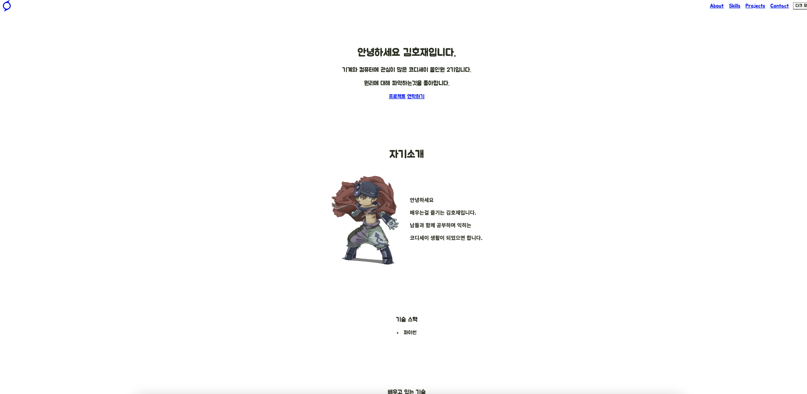
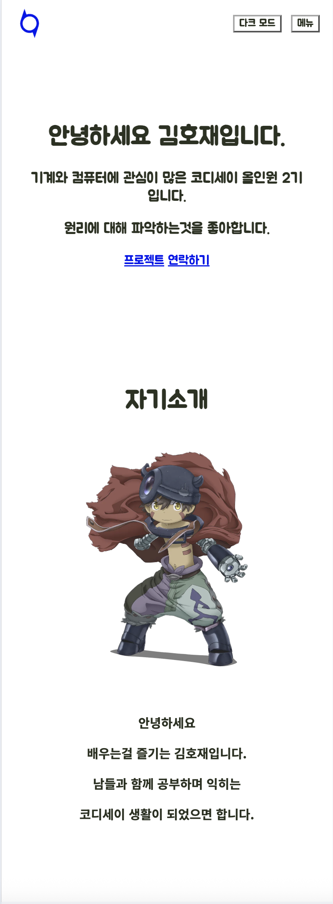
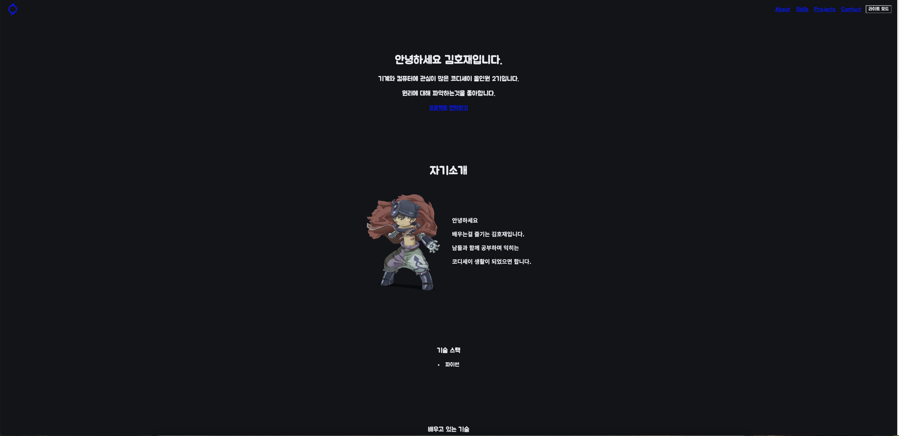

# B01-01 나만의 포트폴리오 웹사이트

외부 라이브러리(React, jQuery, Bootstrap 등) 없이 **순수 HTML / CSS / JavaScript**로 구현한 반응형 개인 포트폴리오 웹사이트입니다.

- **배포 URL:** https://ghwo6.github.io/B01-01/
- **GitHub 저장소:** https://github.com/ghwo6/B01-01

---

## 사용 기술

- **Markup:** HTML5 (시맨틱 태그: `header`, `nav`, `main`, `section`, `article`, `footer`)
- **Styling:** CSS3 (CSS 변수, `[data-theme="dark"]`, Flexbox, Grid, 모바일 퍼스트 반응형)
- **Script:** Vanilla JavaScript (ES6+, `fetch` + `async/await`, `IntersectionObserver`, `localStorage`)
- **Fonts & Icons:** Google Fonts (`Jua`, `Noto Sans KR`), Font Awesome
- **External API:** GitHub REST API, EmailJS REST API

---

## 주요 구현 기능

1. **반응형 내비게이션 & 햄버거 메뉴**
   - 모바일 환경에서 햄버거 버튼으로 메뉴 열기/닫기 및 링크 클릭 시 자동 닫힘
   - 태블릿(`768px`) 이상에서 가로 메뉴로 전환
2. **다크 모드 & 시스템 테마 연동**
   - OS 다크 모드(`prefers-color-scheme`) 초기 감지
   - 버튼 클릭 시 `data-theme` 전환 및 `localStorage` 저장으로 새로고침 후에도 유지
3. **스크롤 인터랙션 & 타이핑 효과**
   - Hero 섹션 제목 타이핑 애니메이션
   - 부드러운 스크롤(`scroll-behavior: smooth`)
   - 스크롤 위치에 따른 헤더 스타일 변경 및 스크롤 탑(`↑`) 버튼 표시
   - `IntersectionObserver`를 활용한 섹션 등장 애니메이션
4. **GitHub API 프로젝트 연동 & 언어별 필터링**
   - GitHub 저장소 목록 비동기 조회 (`fetch` + `async/await`)
   - 로딩 / 성공 / 에러(403 레이트리밋 포함 + 다시 시도) / 빈 상태 4가지 UI 구현
   - `Set`과 `array.filter()`를 활용한 언어별 필터 버튼 제공
5. **Contact 폼 유효성 검증 & 메일 전송**
   - `input` 실시간 검증 및 `submit` 제출 검증 (이름, 이메일 정규식, 메시지)
   - EmailJS REST API(`fetch` POST)를 통한 실제 메일 전송

---

## 인터랙션 기준값 (Thresholds)

`todolist/todolist.md` 기준에 맞춰 아래 기준값으로 구현했습니다.

| 항목 | 기준값 | 비고 |
| --- | --- | --- |
| 헤더 스크롤 스타일 적용 | `scrollY > 60px` | `.header.scrolled` 클래스 추가 |
| 스크롤 탑(`↑`) 버튼 표시 | `scrollY > 300px` | `.scroll-top.visible` 클래스 추가 |
| 섹션 등장 애니메이션 | `threshold: 0.2` | `IntersectionObserver` 기준 |
| 반응형 브레이크포인트 | `min-width: 768px`, `1024px` | 모바일 퍼스트 (태블릿 / 데스크톱) |

---

## 폴더 구조

```text
B01-01/
├── index.html          # 메인 HTML 문서
├── css/
│   └── style.css       # 스타일시트 (테마 변수, 반응형, 애니메이션)
├── js/
│   └── script.js       # 인터랙션, 폼 검증, GitHub API, EmailJS 연동
├── images/             # 파비콘 및 프로필 이미지
└── README.md           # 프로젝트 문서
```

---

## 스크린샷

### 데스크톱 화면


### 모바일 화면


### 다크 모드 화면

