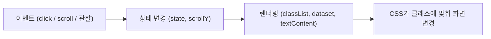

# 4~5단계 JavaScript 가이드 (DOM · 이벤트 · 인터랙션)

- 일시: 2026-11-11 19:13
- 관련 todolist: **4. JavaScript 기초** (79~85행), **5. 인터랙션 구현** (89~99행)
- 참고: 아래 코드는 예시입니다. `js/main.js`는 직접 만들어 작성합니다.

> 지킬 규칙 (todolist 0번)
> - `var` 금지 → `const`, `let`만 사용
> - HTML `onclick` 금지 → `addEventListener` 사용
> - 인라인 스타일 금지 → JS에서는 `style` 대신 **클래스만 붙이고 떼기**

---

## 0. 먼저 HTML/JS 연결 확인
```html
<script src="js/main.js" defer></script>
```
`defer`를 붙이면 HTML을 다 읽은 뒤에 JS가 실행됩니다. 그래서 `querySelector`로 요소를 찾을 때 `null`이 나오지 않습니다.

---

## 4단계. JavaScript 기초

| 하고 싶은 것 | 메서드 / 속성 |
|---|---|
| 요소 1개 선택 | `document.querySelector(".nav")` |
| 요소 여러 개 선택 | `document.querySelectorAll(".nav-menu a")` |
| 글자만 바꾸기 | `el.textContent = "..."` |
| HTML 통째로 넣기 | `el.innerHTML = "<p>...</p>"` |
| 클래스 붙이기 / 떼기 / 토글 | `el.classList.add / remove / toggle("active")` |
| 이벤트 연결 | `el.addEventListener("click", handler)` |
| 기본 동작 막기 | `event.preventDefault()` |

> `textContent`는 글자로만 넣어서 안전합니다. `innerHTML`은 태그까지 해석하니, 직접 만든 템플릿을 넣을 때만 쓰세요.

### 기본 패턴: 선택 → 이벤트 연결 → 클래스 변경
```js
const button = document.querySelector(".hamburger");

button.addEventListener("click", () => {
    // 상태 변경 → 화면 변경
});
```

---

## 5단계. 인터랙션 구현

### a. 햄버거 메뉴 토글
```js
const hamburger = document.querySelector(".hamburger");
const nav = document.querySelector(".nav");
const navLinks = document.querySelectorAll(".nav-menu a");

hamburger.addEventListener("click", () => {
    nav.classList.toggle("active");
});

// (권장) 메뉴 링크를 누르면 메뉴 닫기
navLinks.forEach((link) => {
    link.addEventListener("click", () => {
        nav.classList.remove("active");
    });
});
```
- CSS에서 `.nav.active`일 때 메뉴가 펼쳐지도록 만들어 둬야 합니다.
- (선택) 접근성을 위해 `hamburger.setAttribute("aria-expanded", ...)`도 함께 바꿔 주면 좋습니다.

### b. 부드러운 스크롤
가장 간단한 방법은 **CSS 한 줄**입니다.
```css
html {
    scroll-behavior: smooth;
    scroll-padding-top: 64px; /* 고정 헤더 높이만큼 */
}
```
JS로 하고 싶다면:
```js
navLinks.forEach((link) => {
    link.addEventListener("click", (event) => {
        event.preventDefault();
        const target = document.querySelector(link.getAttribute("href")); // "#about"
        target.scrollIntoView({ behavior: "smooth" });
    });
});
```

### c. 스크롤 탑 버튼 (300px) + d. 네비 스타일 변경 (60px)
**둘 다 `scroll` 이벤트에서 `window.scrollY`를 보면 되니까 한 핸들러로 묶습니다.**
```js
const header = document.querySelector(".header");
const scrollTopBtn = document.querySelector(".scroll-top");

const SCROLL_TOP_LIMIT = 300; // 기준값 바꾸면 README에 적기
const HEADER_LIMIT = 60;

window.addEventListener("scroll", () => {
    const y = window.scrollY;

    header.classList.toggle("scrolled", y >= HEADER_LIMIT);
    scrollTopBtn.classList.toggle("visible", y >= SCROLL_TOP_LIMIT);
});

scrollTopBtn.addEventListener("click", () => {
    window.scrollTo({ top: 0, behavior: "smooth" });
});
```
> `classList.toggle("이름", 조건)`처럼 두 번째 인자를 주면, 조건이 `true`일 때 붙이고 `false`일 때 뗍니다. `if/else`보다 짧게 쓸 수 있습니다.

### e. 다크 모드 토글 + localStorage
"상태 → 렌더링" 흐름이 잘 보이도록 **state 객체 + render 함수**로 나눠 봅니다. (todolist 9번)
```js
const themeToggle = document.querySelector(".theme-toggle");

// 1) 상태
const state = {
    theme: localStorage.getItem("theme") || "light", // 저장값 읽기
};

// 2) 렌더링: 상태를 화면에 반영
const renderTheme = () => {
    document.documentElement.dataset.theme = state.theme; // <html data-theme="dark">
    themeToggle.textContent = state.theme === "dark" ? "☀️" : "🌙";
};

// 3) 이벤트 → 상태 변경 → 저장 → 렌더링
themeToggle.addEventListener("click", () => {
    state.theme = state.theme === "dark" ? "light" : "dark";
    localStorage.setItem("theme", state.theme);
    renderTheme();
});

// 페이지 로드 시 한 번 적용
renderTheme();
```
- CSS에는 `[data-theme="dark"] { ... }` 변수가 정의되어 있어야 합니다.
- (보너스) 저장값이 없을 때 `window.matchMedia("(prefers-color-scheme: dark)").matches`로 시스템 설정을 따를 수 있습니다.

### f. 스크롤 애니메이션 (Intersection Observer)
`scroll` 이벤트로 위치를 계속 계산하는 대신, **요소가 화면에 들어왔는지 브라우저가 알려 줍니다.**
```js
const fadeEls = document.querySelectorAll(".fade-in");

const observer = new IntersectionObserver(
    (entries) => {
        entries.forEach((entry) => {
            if (entry.isIntersecting) {
                entry.target.classList.add("visible");
                observer.unobserve(entry.target); // 한 번만 실행
            }
        });
    },
    { threshold: 0.2 } // 20% 보이면 실행 (바꾸면 README에 적기)
);

fadeEls.forEach((el) => observer.observe(el));
```
- HTML에서 애니메이션을 줄 섹션에 `class="fade-in"`을 붙입니다.
- CSS에는 `.fade-in`(투명)과 `.fade-in.visible`(보임) 스타일이 필요합니다.

---

## 흐름 한눈에 보기


| 기능 | 이벤트 | 상태 | 화면 변경 |
|---|---|---|---|
| 햄버거 | `click` | 메뉴 열림 여부 | `.nav.active` |
| 네비 배경 | `scroll` | `scrollY >= 60` | `.header.scrolled` |
| 스크롤 탑 | `scroll` | `scrollY >= 300` | `.scroll-top.visible` |
| 다크 모드 | `click` | `state.theme` + localStorage | `data-theme="dark"` |
| 스크롤 애니메이션 | Intersection Observer | 화면 안에 들어옴 | `.fade-in.visible` |

---

## 자주 하는 실수
- **`null` 에러:** `querySelector`의 클래스 이름이 HTML과 다르거나, `defer`를 빠뜨림
- **이벤트 핸들러를 바로 실행:** `addEventListener("click", handler())` ❌ → `addEventListener("click", handler)` ✅
- **JS에서 `el.style.display = "none"`:** 인라인 스타일과 같은 문제 → 클래스를 붙이고 CSS에서 처리
- **다크 모드가 새로고침하면 풀림:** 페이지 로드 시 `renderTheme()`를 호출하지 않음

---

## 4~5단계 체크리스트
- [ ] `querySelector` / `querySelectorAll`로 요소 선택
- [ ] `textContent` / `innerHTML`로 내용 변경
- [ ] `classList.add` / `remove` / `toggle` 사용
- [ ] `click`, `scroll` 이벤트 처리 (`submit`, `input`은 6단계 폼에서)
- [ ] a. 햄버거 토글 + 링크 클릭 시 닫기
- [ ] b. 부드러운 스크롤
- [ ] c. 스크롤 300px 이상 → 스크롤 탑 버튼 표시, 클릭 시 맨 위로
- [ ] d. 스크롤 60px 이상 → 네비 배경 변경
- [ ] e. 다크 모드 토글 + localStorage 유지
- [ ] f. Intersection Observer 스크롤 애니메이션 (threshold 0.2)

다음 단계: **6단계 폼 UX** (필수값, 이메일 정규식, 실시간 에러 메시지, 성공 메시지)
