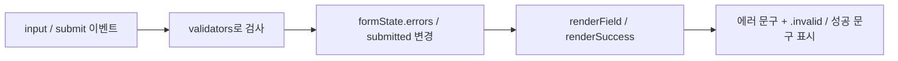

# 6단계 폼 UX 가이드 (Contact 폼 검증)

- 일시: 2026-11-11 19:32
- 관련 todolist: **6. 폼 UX (Contact)** (103~110행), **9. 상태 관리 패턴** (146행)
- 참고: 아래 코드는 예시입니다. `index.html`, `css/style.css`, `js/main.js`에 직접 작성합니다.

---

## 목표
| 요구사항 | 방법 |
|---|---|
| 이름 / 이메일 / 메시지 필드 | `<input>`, `<textarea>` + `<label for>` |
| 빈 필드 제출 불가 | `value.trim() === ""` 검사 |
| 이메일 형식 검증 | 정규식 `test()` |
| 에러 메시지를 입력칸 근처에, 실시간으로 | `input` 이벤트 + 입력칸 아래 `<p>` |
| 기본 제출 동작 막기 | `submit` 이벤트에서 `event.preventDefault()` |
| 통과 시 성공 메시지 + 초기화 | `textContent` + `form.reset()` |

---

## 1. HTML
```html
<section id="contact">
    <h2>Contact</h2>
    <form class="contact-form" novalidate>
        <div class="form-group">
            <label for="name">이름</label>
            <input type="text" id="name" name="name">
            <p class="error-message" id="name-error"></p>
        </div>

        <div class="form-group">
            <label for="email">이메일</label>
            <input type="email" id="email" name="email">
            <p class="error-message" id="email-error"></p>
        </div>

        <div class="form-group">
            <label for="message">메시지</label>
            <textarea id="message" name="message" rows="5"></textarea>
            <p class="error-message" id="message-error"></p>
        </div>

        <button type="submit" class="btn">보내기</button>
        <p class="success-message"></p>
    </form>
</section>
```
- **`label for="name"` ↔ `input id="name"`** 가 같아야 합니다. (todolist 54행) 라벨을 클릭하면 입력칸에 커서가 들어가는지로 확인할 수 있습니다.
- **`novalidate`**: 브라우저 기본 말풍선 검증을 끄고, 우리가 만든 JS 검증과 에러 메시지를 씁니다.
- 에러 메시지 `<p>`는 처음엔 비워 두고, JS가 글자를 채웁니다.

---

## 2. CSS
```css
.error-message {
    min-height: 1.2em;   /* 메시지가 생겨도 레이아웃이 덜컹거리지 않게 */
    font-size: 0.875rem;
    color: #e11d48;
}

/* 검증 실패한 칸: JS가 .invalid를 붙임 */
.form-group.invalid input,
.form-group.invalid textarea {
    border-color: #e11d48;
}

.success-message {
    color: #16a34a;
    font-weight: 600;
}
```

---

## 3. JavaScript — 상태 → 렌더링 구조로 작성

### 3-1. 요소 선택 + 검증 규칙
```js
const form = document.querySelector(".contact-form");
const successMessage = document.querySelector(".success-message");

const EMAIL_REGEX = /^[^\s@]+@[^\s@]+\.[^\s@]+$/;

// 필드별 검증 함수: 문제가 있으면 에러 문구, 없으면 빈 문자열 반환
const validators = {
    name: (value) => (value.trim() === "" ? "이름을 입력해 주세요." : ""),
    email: (value) => {
        if (value.trim() === "") return "이메일을 입력해 주세요.";
        if (!EMAIL_REGEX.test(value.trim())) return "올바른 이메일 형식이 아닙니다.";
        return "";
    },
    message: (value) => (value.trim() === "" ? "메시지를 입력해 주세요." : ""),
};
```

> **정규식 읽는 법** `/^[^\s@]+@[^\s@]+\.[^\s@]+$/`
> - `^` … `$`: 처음부터 끝까지 전체가
> - `[^\s@]+`: 공백과 `@`가 아닌 글자 1개 이상
> - `@`, `\.`: 실제 `@`와 `.` 문자
> - 즉 **"글자@글자.글자"** 모양인지 검사합니다.

### 3-2. 상태
```js
const formState = {
    errors: { name: "", email: "", message: "" },
    submitted: false,
};
```

### 3-3. 렌더링: 상태를 화면에 반영
```js
const renderField = (field) => {
    const message = formState.errors[field];
    const input = document.querySelector(`#${field}`);
    const errorEl = document.querySelector(`#${field}-error`);

    errorEl.textContent = message;
    input.closest(".form-group").classList.toggle("invalid", message !== "");
};

const renderSuccess = () => {
    successMessage.textContent = formState.submitted
        ? "메시지가 전송되었습니다. 감사합니다!"
        : "";
};
```

### 3-4. 이벤트 → 상태 변경 → 렌더링
**실시간 검증 (`input` 이벤트)**
```js
Object.keys(validators).forEach((field) => {
    const input = document.querySelector(`#${field}`);

    input.addEventListener("input", () => {
        formState.errors[field] = validators[field](input.value); // 상태 변경
        formState.submitted = false;
        renderField(field);                                       // 렌더링
        renderSuccess();
    });
});
```

**제출 (`submit` 이벤트)**
```js
form.addEventListener("submit", (event) => {
    event.preventDefault(); // 새로고침(기본 제출) 막기

    // 1) 모든 필드 검사 → 상태 변경
    Object.keys(validators).forEach((field) => {
        const { value } = document.querySelector(`#${field}`); // 구조분해 할당
        formState.errors[field] = validators[field](value);
    });

    const isValid = Object.values(formState.errors).every((msg) => msg === "");
    formState.submitted = isValid;

    // 2) 렌더링
    Object.keys(validators).forEach(renderField);
    renderSuccess();

    // 3) 통과 시 폼 초기화
    if (isValid) {
        form.reset();
    }
});
```

> 이벤트는 `form`의 **`submit`** 에 겁니다. 버튼의 `click`에 걸면 입력칸에서 Enter로 제출할 때는 동작하지 않습니다.

---

## 흐름 한눈에 보기


이 흐름이 todolist 9번의 **"폼 입력 → 유효성 상태 변경 → 에러 메시지 표시/숨김"** 에 해당합니다.

---

## 테스트 시나리오
| 해 볼 것 | 기대 결과 |
|---|---|
| 아무것도 안 쓰고 보내기 | 세 칸 모두 에러 + 빨간 테두리, 성공 메시지 없음 |
| 이름에 공백만 입력 | "이름을 입력해 주세요." (`trim()` 확인) |
| 이메일에 `abc` 입력 | "올바른 이메일 형식이 아닙니다." |
| 에러가 난 칸에 다시 올바르게 입력 | 타이핑하는 순간 에러가 사라짐 |
| 모두 올바르게 입력 후 보내기 | 성공 메시지 + 입력칸 비워짐, 페이지 새로고침 없음 |
| 라벨 "이름" 클릭 | 이름 입력칸에 커서가 들어감 |

---

## 자주 하는 실수
- **`preventDefault()`를 빼먹음:** 제출하면 페이지가 새로고침되며 메시지가 사라짐
- **`id`와 `for` 철자 불일치:** 라벨 클릭이 안 되고, JS의 `#${field}-error` 선택도 `null`
- **`value`만 검사하고 `trim()` 안 함:** 공백만 입력해도 통과됨
- **에러 표시를 `style.display`로 처리:** 인라인 스타일 규칙 위반 → `textContent`와 클래스로 처리

---

## 6단계 체크리스트
- [ ] 이름 / 이메일 / 메시지 필드 + `label for` ↔ `id` 매칭
- [ ] 빈 필드 제출 불가 (`trim()`)
- [ ] 이메일 정규식 검증
- [ ] 입력칸 아래 에러 메시지, `input` 이벤트로 실시간 표시/숨김
- [ ] `submit`에서 `event.preventDefault()`
- [ ] 통과 시 성공 메시지 + `form.reset()`

다음 단계: **7~9단계 GitHub API 연동** (`fetch` + `async/await`, 로딩/성공/에러/빈 상태, `map`으로 카드 렌더링)
