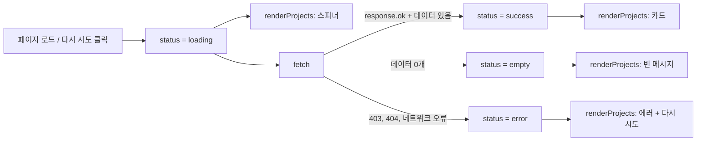

# 7~9단계 GitHub API 연동 가이드 (ES6+ · 비동기 · 상태 관리)

- 일시: 2026-11-11 19:45
- 관련 todolist: **7. ES6+ 문법 & 배열 메서드** (114~122행), **8. 비동기 처리 & GitHub API** (126~136행), **9. 상태 관리 패턴** (140~147행)
- 참고: 아래 코드는 예시입니다. `index.html`, `css/style.css`, `js/main.js`에 직접 작성합니다.

---

## 목표
GitHub에서 내 저장소 목록을 받아와 Projects 섹션에 카드로 보여 줍니다. 이때 **4가지 상태**를 화면에 표현해야 합니다.

| 상태 | 화면 |
|---|---|
| 로딩 (`loading`) | 스피너 또는 "로딩 중..." |
| 성공 (`success`) | 저장소 카드 목록 (이름, 설명, 언어, Stars, 링크) |
| 에러 (`error`) | "프로젝트를 불러올 수 없습니다" + **[다시 시도] 버튼** |
| 빈 상태 (`empty`) | "표시할 프로젝트가 없습니다" |

엔드포인트: `https://api.github.com/users/{본인아이디}/repos`

> **레이트리밋 주의:** 로그인 없이 호출하면 **시간당 60회**까지만 됩니다. Live Server가 저장할 때마다 새로고침하므로 금방 찰 수 있습니다. 초과하면 **403** 응답이 오고, 이것도 에러 상태로 보여 줘야 합니다. (todolist 136행)

---

## 1. 7단계 ES6+ 문법 미리 보기

| 문법 | 예시 | 어디서 쓰나 |
|---|---|---|
| 화살표 함수 | `const add = (a, b) => a + b;` | 이벤트 핸들러, 배열 메서드 콜백 |
| 템플릿 리터럴 | `` `<h3>${name}</h3>` `` | 카드 HTML 만들기 |
| 구조분해 할당 | `const { name, html_url } = repo;` | API 데이터에서 필요한 값만 꺼내기 |
| `map` | `repos.map((repo) => createCard(repo))` | 데이터 배열 → HTML 문자열 배열 |
| `filter` | `repos.filter((repo) => !repo.fork)` | 조건에 맞는 것만 남기기 |
| `forEach` | `buttons.forEach((btn) => ...)` | 배열 돌면서 실행만 (반환값 없음) |

> `map`과 `forEach`의 차이: **`map`은 새 배열을 돌려주고**, `forEach`는 아무것도 돌려주지 않습니다. 카드를 만들 땐 `map`을 씁니다.

---

## 2. HTML
```html
<section id="projects">
    <h2>Projects</h2>
    <div class="project-status" aria-live="polite"></div>
    <div class="project-list"></div>
</section>
```
- `.project-status`: 로딩 / 에러 / 빈 상태 메시지를 보여 줄 자리
- `.project-list`: 카드(`<article>`)가 들어갈 자리 (CSS에서 Grid)
- `aria-live="polite"`: 내용이 바뀌면 스크린리더가 읽어 줍니다.

---

## 3. JavaScript

### 3-1. 상태
```js
const GITHUB_USER = "본인아이디";
const API_URL = `https://api.github.com/users/${GITHUB_USER}/repos?sort=updated&per_page=100`;

const projectState = {
    status: "idle",   // "loading" | "success" | "error" | "empty"
    repos: [],
    errorMessage: "",
};
```

### 3-2. 카드 하나 만들기 (구조분해 + 템플릿 리터럴)
```js
const createCard = (repo) => {
    const { name, description, html_url, stargazers_count, language } = repo;

    return `
        <article class="project-card">
            <h3>${name}</h3>
            <p>${description ?? "설명이 없습니다."}</p>
            <ul class="project-meta">
                <li>${language ?? "언어 정보 없음"}</li>
                <li>⭐ ${stargazers_count}</li>
            </ul>
            <a href="${html_url}" target="_blank" rel="noopener noreferrer">GitHub에서 보기</a>
        </article>
    `;
};
```
- `??` (널 병합 연산자): 값이 `null`이나 `undefined`일 때 오른쪽 값을 씁니다. 설명이 없는 저장소가 많아서 필요합니다.
- `target="_blank"`로 새 탭을 열 때는 `rel="noopener noreferrer"`를 같이 씁니다.

### 3-3. 렌더링: 상태에 따라 화면 바꾸기
```js
const statusEl = document.querySelector(".project-status");
const listEl = document.querySelector(".project-list");

const renderProjects = () => {
    const { status, repos, errorMessage } = projectState;

    // 매번 초기화하고 상태에 맞는 것만 다시 그림
    statusEl.innerHTML = "";
    listEl.innerHTML = "";

    if (status === "loading") {
        statusEl.innerHTML = `<div class="spinner"></div><p>로딩 중...</p>`;
    } else if (status === "error") {
        statusEl.innerHTML = `
            <p>프로젝트를 불러올 수 없습니다. ${errorMessage}</p>
            <button type="button" class="btn retry-btn">다시 시도</button>
        `;
    } else if (status === "empty") {
        statusEl.textContent = "표시할 프로젝트가 없습니다.";
    } else if (status === "success") {
        listEl.innerHTML = repos.map(createCard).join("");
    }
};
```
- `repos.map(createCard)`은 HTML 문자열 **배열**을 돌려줍니다. `.join("")`으로 하나의 문자열로 합쳐야 쉼표가 화면에 찍히지 않습니다.

### 3-4. 데이터 가져오기 (`fetch` + `async/await` + `try/catch`)
```js
const fetchProjects = async () => {
    // 1) 로딩 상태
    projectState.status = "loading";
    renderProjects();

    try {
        const response = await fetch(API_URL);

        // fetch는 404, 403이어도 에러를 던지지 않음 → 직접 확인
        if (!response.ok) {
            if (response.status === 403) {
                throw new Error("(요청 한도 초과: 잠시 후 다시 시도해 주세요)");
            }
            throw new Error(`(오류 코드: ${response.status})`);
        }

        const data = await response.json();
        const repos = data.filter((repo) => !repo.fork); // (선택) 포크한 저장소 제외

        // 2) 성공 또는 빈 상태
        projectState.repos = repos;
        projectState.status = repos.length === 0 ? "empty" : "success";
    } catch (error) {
        // 3) 에러 상태 (네트워크 끊김 포함)
        projectState.status = "error";
        projectState.errorMessage = error.message;
    }

    renderProjects();
};

fetchProjects(); // 페이지 로드 시 실행
```

> **`response.ok` 체크가 꼭 필요한 이유:** `fetch`는 **네트워크 자체가 실패할 때만** `catch`로 갑니다. 서버가 403이나 404를 돌려줘도 "응답은 받았다"고 보고 정상 진행합니다. 그래서 `response.ok`(상태 코드 200~299)를 직접 확인하고, 아니면 `throw`해서 `catch`로 보내야 합니다.

### 3-5. [다시 시도] 버튼
버튼은 에러가 났을 때 `innerHTML`로 **나중에 생기는 요소**입니다. 그래서 페이지가 처음 로드될 때 `querySelector(".retry-btn")`로 찾으면 `null`이 나옵니다. **항상 존재하는 부모(`statusEl`)에 이벤트를 걸고**, 무엇이 클릭됐는지 확인합니다. (이벤트 위임)
```js
statusEl.addEventListener("click", (event) => {
    if (event.target.matches(".retry-btn")) {
        fetchProjects();
    }
});
```

---

## 4. CSS (추가로 필요한 것)
```css
.project-list {
    display: grid;
    grid-template-columns: repeat(auto-fit, minmax(260px, 1fr));
    gap: 2rem;
}

.project-meta {
    display: flex;
    gap: 1rem;
    font-size: 0.875rem;
}
```
스피너와 카드 hover 스타일은 [3단계 CSS 가이드](2026-11-11_1910_3단계_CSS_가이드.md)의 7~8번을 참고하세요.

---

## 5. 9단계 상태 관리 패턴 정리

todolist 9번은 **"상태 → 렌더링" 흐름 3가지 이상**을 요구합니다. 지금까지 가이드대로 만들면 이미 3가지가 됩니다.

| # | 이벤트 | 상태 | 렌더 함수 | 가이드 |
|---|---|---|---|---|
| 1 | 다크 모드 버튼 `click` | `state.theme` | `renderTheme()` | 4~5단계 |
| 2 | 페이지 로드 / 다시 시도 | `projectState.status` | `renderProjects()` | 이 문서 |
| 3 | 폼 `input` / `submit` | `formState.errors` | `renderField()` | 6단계 |
| (선택) 4 | 필터 버튼 `click` | `projectState.filter` | `renderProjects()` | 아래 보너스 |



**규칙 하나만 기억하세요:** 화면을 직접 고치지 말고, **상태를 바꾼 다음 render 함수를 부릅니다.** React의 `setState` → 다시 렌더링과 같은 생각입니다.

---

## 6. (보너스) 언어별 필터 버튼
```js
projectState.filter = "All";

const getVisibleRepos = () =>
    projectState.filter === "All"
        ? projectState.repos
        : projectState.repos.filter((repo) => repo.language === projectState.filter);
```
- `renderProjects`의 성공 분기에서 `repos` 대신 `getVisibleRepos()`를 씁니다.
- 필터 버튼 목록은 `new Set(repos.map((repo) => repo.language).filter(Boolean))`로 중복 없이 만들 수 있습니다.
- 버튼 클릭 → `projectState.filter` 변경 → `renderProjects()` 호출

---

## 7. 테스트 방법
| 확인할 상태 | 방법 |
|---|---|
| 로딩 | 개발자 도구(F12) → Network → **Slow 3G**로 바꾸고 새로고침 |
| 성공 | 정상적으로 새로고침 |
| 에러 | Network → **Offline** 체크 후 새로고침, 또는 `GITHUB_USER`를 없는 아이디로 바꾸기 (404) |
| 다시 시도 | Offline에서 에러가 난 상태로 Offline 해제 → [다시 시도] 클릭 |
| 빈 상태 | 저장소가 없는 계정 아이디로 바꿔 보기, 또는 잠시 `filter(() => false)`로 테스트 |

> 남은 호출 횟수는 Network 탭에서 응답 헤더 `x-ratelimit-remaining`으로 확인할 수 있습니다.

---

## 자주 하는 실수
- **`await`를 `async` 없는 함수에서 씀:** 문법 에러 → 함수 앞에 `async`
- **`response.json()` 앞에 `await` 빠뜨림:** 데이터 대신 Promise가 들어감
- **`map` 결과에 `join("")` 안 함:** 카드 사이에 쉼표(`,`)가 찍힘
- **다시 시도 버튼에 직접 `addEventListener`:** 나중에 생긴 요소라 `null` → 이벤트 위임 사용
- **`response.ok` 확인 안 함:** 403이 와도 성공으로 처리됨

---

## 7~9단계 체크리스트
- [ ] 화살표 함수, 템플릿 리터럴, 구조분해 할당 사용
- [ ] `map`으로 카드 생성, `forEach`로 순회, (선택) `filter`
- [ ] `fetch` + `async/await`로 저장소 목록 호출
- [ ] `try/catch` + `response.ok` 확인
- [ ] 로딩 / 성공 / 에러(+다시 시도) / 빈 상태 UI
- [ ] 403 레이트리밋도 에러 상태로 표시
- [ ] state 객체 + render 함수 분리, "상태 → 렌더링" 흐름 3가지 이상

다음 단계: **10~11단계 배포 & 문서화** (GitHub Pages 배포, README 작성, 스크린샷)
