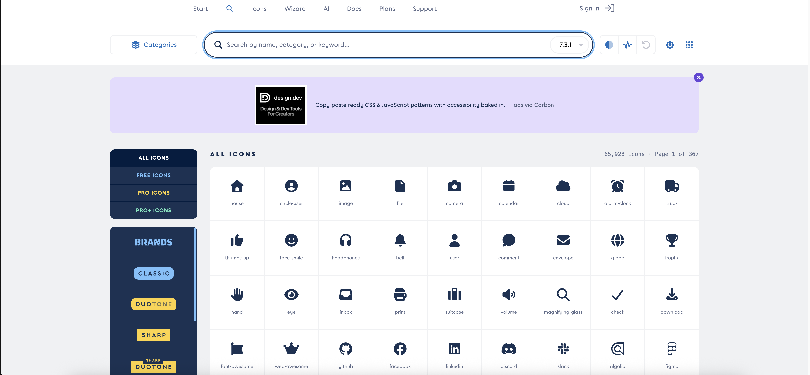

font awesome 과 Google Fonts를 허용한다고 하여 찾아보았다.

font awesome은 아이콘을 제공하는 웹사이트로 개발자가 원하는 아이콘이 있다면 웹, 앱등에 넣을수 있다고 한다.

google Fonts는 웹으로 제공하는 폰트 라이브러리라고 하고 현재는 정보 수집 단계라 AI답변을 표 형식으로  남겨두었다.

+----+---------------------------+-----------------------------+-----------------------------+
| No | 추천 폰트 조합             | 느낌 / 분위기                 | 추천 사용처                   |
+----+---------------------------+-----------------------------+-----------------------------+
| 1  | Inter + Noto Sans KR       | 깔끔함, 현대적, 가독성 좋음     | 포트폴리오, 회사 소개, 쇼핑몰 |
| 2  | Roboto + Noto Sans KR      | 구글/앱 느낌, 안정적           | 앱 소개, 대시보드, 서비스 웹  |
| 3  | Nunito + Noto Sans KR      | 둥글고 부드러움, 친근함         | 교육 사이트, 키즈, 캐주얼 웹  |
| 4  | Montserrat + Noto Sans KR  | 세련됨, 제목이 강하게 보임      | 랜딩 페이지, 브랜드 사이트    | 
| 5  | Noto Serif KR              | 차분함, 고급스러움, 명조 느낌   | 블로그, 에세이, 전통적 사이트 |
+----+---------------------------+-----------------------------+-----------------------------+

### 사용 코드도 같이 정리하면 좋습니다.
+--------------------------+------------------------------------------------+
| 조합                     | CSS font-family 예시                            |
+--------------------------+------------------------------------------------+
| Inter + Noto Sans KR     | 'Inter', 'Noto Sans KR', sans-serif             |
| Roboto + Noto Sans KR    | 'Roboto', 'Noto Sans KR', sans-serif            |
| Nunito + Noto Sans KR    | 'Nunito', 'Noto Sans KR', sans-serif            |
| Montserrat + Noto Sans KR| 'Montserrat', 'Noto Sans KR', sans-serif        |
| Noto Serif KR            | 'Noto Serif KR', serif                          |
+--------------------------+------------------------------------------------+
### 가장 추천하는 기본 세팅은 이거예요.

body {
  font-family: 'Inter', 'Noto Sans KR', sans-serif;
}

### 그리고 HTML <head> 안에는 예를 들어 이렇게 넣습니다.

<link rel="preconnect" href="https://fonts.googleapis.com">
<link rel="preconnect" href="https://fonts.gstatic.com" crossorigin>

<link href="https://fonts.googleapis.com/css2?family=Inter:wght@400;500;700&family=Noto+Sans+KR:wght@400;500;700&display=swap" rel="stylesheet">